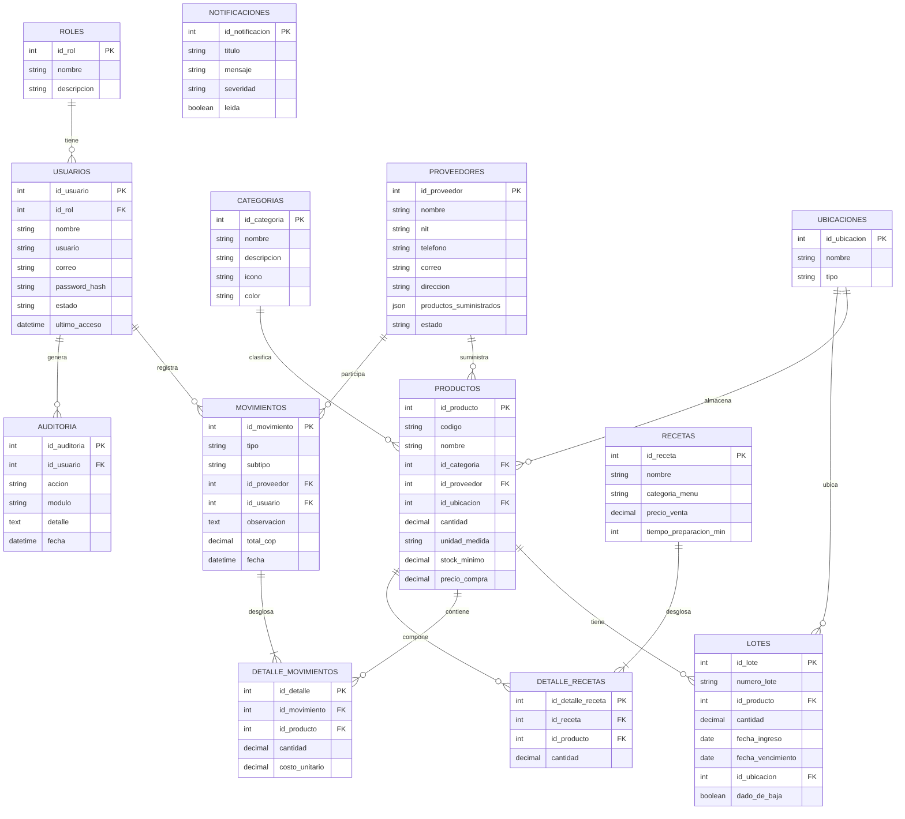

# Arquitectura del Sistema de Inventarios GAMA (FastStock)

## 1. Visión General
El Sistema de Inventarios GAMA (FastStock) es una aplicación web empresarial orientada a la gestión operativa de materias primas, insumos, lotes, proveedores, recetas culinarias y movimientos de stock (Kardex) para restaurantes de comida rápida.

Originalmente prototipado en TypeScript para validar entidades en AI Studio, este proyecto ha sido completamente reescrito bajo una arquitectura **MVC (Modelo-Vista-Controlador)** en **Laravel (PHP 8.2+)**, persistido en **MySQL (XAMPP)**, presentado con **Bootstrap 5.3** y versionado a nivel de base de datos con **Liquibase**.

---

## 2. Diagrama Entidad-Relación (Modelo Conceptual)

---

## 3. Adaptación del Modelado TypeScript a Laravel Eloquent

| Entidad TypeScript Original | Tabla MySQL Final | Modelo Eloquent | Características y Reglas Clave |
| :--- | :--- | :--- | :--- |
| `Usuario` | `usuarios` | `App\Models\User` | Autenticación Laravel, roles (`id_rol`), hash bcrypt, estados Activo/Inactivo. |
| `RolUsuario` | `roles` | `App\Models\Role` | Perfiles: Administrador, Encargado de inventario, Empleado. |
| `Categoria` | `categorias` | `App\Models\Categoria` | Categorías con color hexadecimal e iconos para la interfaz visual. |
| `Proveedor` | `proveedores` | `App\Models\Proveedor` | NIT único, catálogo de suministros en JSON y estado. |
| `Ubicacion` | `ubicaciones` | `App\Models\Ubicacion` | Áreas de bodega: Ambiente, Refrigerado y Congelado. |
| `Producto` | `productos` | `App\Models\Producto` | Código de barras único, stock con decimales, accessor de alerta (`bajo_stock`, `agotado`). |
| `Movimiento` | `movimientos` | `App\Models\Movimiento` | Tipo Entrada/Salida, subtipos de Kardex (Compra, Receta, Merma, Ajuste). |
| `DetalleMovimiento` | `detalle_movimientos` | `App\Models\DetalleMovimiento` | Líneas de transacción con cantidad y costo unitario en COP. |
| `Receta` | `recetas` | `App\Models\Receta` | Escandallo culinario con precio de venta y tiempo estimado de cocina. |
| `DetalleReceta` | `detalle_recetas` | `App\Models\DetalleReceta` | Insumos exactos por porción de receta para descarga automática. |
| `Lote` | `lotes` | `App\Models\Lote` | Control de caducidad, semáforo de vencimiento (vigente, próximo a vencer, vencido). |
| `Notificacion` | `notificaciones` | `App\Models\Notificacion` | Alertas del sistema sobre insumos críticos o vencimientos. |
| `RegistroAuditoria` | `auditoria` | `App\Models\Auditoria` | Trazabilidad inmutable de acciones realizadas por cada usuario. |

---

## 4. Stack Tecnológico

- **Backend**: Laravel 10 / PHP 8.2 (con soporte en XAMPP).
- **Base de Datos**: MySQL 8.x / MariaDB 10.4+.
- **Frontend / Capa de Presentación**: Blade Templates + Bootstrap 5.3 + Bootstrap Icons.
- **Control de Versiones de Base de Datos**: Liquibase 4.x.
- **Control de Código Fuente**: Git + GitHub (rama activa: `dev`).
